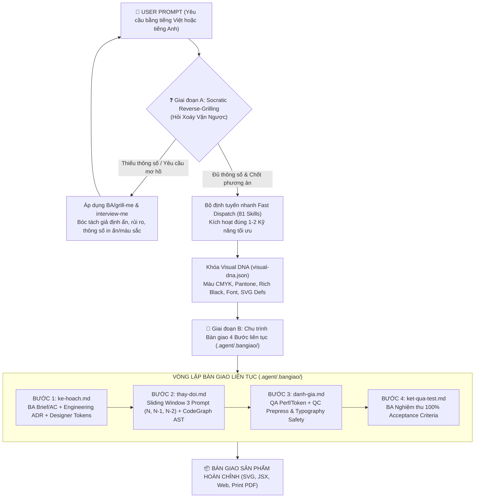

# 🎨 AGENCY CREATIVE & ENGINEERING AI ORCHESTRATOR
### Autonomous Zero-Waste Router · Socratic Reverse-Grilling · 4-Step Continuous Bangiao Pipeline · 81 Specialized Production Skills

[](.agent/skills/)
[-00F0FF.svg?style=for-the-badge&logo=checkmarx)](tests/test_agency_system.py)
[](#-hệ-sinh-thái-tương-thích-đa-nền-tảng)
[](.agent/.bangiao/visual-dna.json)
[](.agent/skills/Designer/adobe-prepress-bridge/)

---

## 📖 MỤC LỤC TỔNG QUAN

1. [Giới thiệu Hệ thống (System Overview)](#-1-giới-thiệu-hệ-thống-system-overview)
2. [Nguyên lý Tối cao: Vòng lặp Socratic & Bàn giao 4 Bước](#-2-nguyên-lý-tối-cao-vòng-lặp-socratic--bàn-giao-4-bước)
3. [Kiến trúc Thuật toán Zero-Waste Router](#-3-kiến-trúc-thuật-toán-zero-waste-router)
4. [Bảng Định Tuyến Nhanh 81 Kỹ Năng (Fast Dispatch Table)](#-4-bảng-định-tuyến-nhanh-81-kỹ-năng-fast-dispatch-table)
5. [Quy trình Sản xuất Đồ họa & Sáng tạo Agency Đỉnh cao](#-5-quy-trình-sản-xuất-đồ-họa--sáng-tạo-agency-đỉnh-cao)
   - [Pack 01: Nhận diện Thương hiệu & Bộ Gen Họa Tiết (Motif Engine)](#pack-01-nhận-diện-thương-hiệu--bộ-gen-họa-tiết-motif-engine)
   - [Pack 02: Vòng đời Digital & Social Media 360](#pack-02-vòng-đời-digital--social-media-360)
   - [Pack 03: Vật phẩm Sự kiện Thực tế & Artcraft Ticketing](#pack-03-vật-phẩm-sự-kiện-thực-tế--artcraft-ticketing)
   - [Pack 04: Không gian Sân khấu LED & POSM Đa tỷ lệ](#pack-04-không-gian-sân-khấu-led--posm-đa-tỷ-lệ)
   - [Pack 05: Web Trải nghiệm Lễ hội & Ra mắt Phi SaaS](#pack-05-web-trải-nghiệm-lễ-hội--ra-mắt-phi-saas)
6. [Cầu nối Chế bản Tiền kỳ In ấn & Adobe ExtendScript (.jsx)](#-6-cầu-nối-chế-bản-tiền-kỳ-in-ấn--adobe-extendscript-jsx)
7. [Visual DNA: Single Source of Truth (`visual-dna.json`)](#-7-visual-dna-single-source-of-truth-visual-dnajson)
8. [Cơ chế CodeGraph AST & Tiết kiệm 97% Context Token](#-8-cơ-chế-codegraph-ast--tiết-kiệm-97-context-token)
9. [Bộ Kiểm thử Tự động 15 Tiêu chí (Automated Test Suite)](#-9-bộ-kiểm-thử-tự-động-15-tiêu-chí-automated-test-suite)
10. [Hướng dẫn Cài đặt & Vận hành Đa Nền tảng](#-10-hướng-dẫn-cài-đặt--vận-hành-đa-nền-tảng)

---

## 🌟 1. GIỚI THIỆU HỆ THỐNG (SYSTEM OVERVIEW)

**Agency Creative & Engineering AI Orchestrator** là hệ thống điều phối trí tuệ nhân tạo chuyên sâu toàn diện dành cho các Creative Agency, Design Studio, Production House và Software Engineering Lab.

Hệ thống kết nối sức mạnh của **81 Kỹ năng chuyên gia (Canonical Skills)** chia làm 6 vai trò mũi nhọn:
- 🎨 **Designer (22 skills):** Kiến trúc sư chiến dịch 360 IMC, Bộ sinh motif vector, Thiết kế Merch/Lightstick/Vé cấn xé, Mascot 4 hướng, Cầu nối in ấn ExtendScript Adobe Illustrator, Poster Swiss Grid, Social Media Safe Zones, 67 Phong cách UI/UX, Motion GSAP, AI Image Prompting.
- 🖥️ **UX.UI (10 skills):** Web sự kiện trải nghiệm Non-SaaS, Frontend Design, Web Artifacts Builder, Figma MCP Sync, React Modular Components, Remotion Video.
- 🛠️ **Engineering (38 skills):** Khung Matt Pocock Engineering, TDD Red-Green-Refactor, Codebase Architecture, Handoff Subagents, Git Guardrails, Bug Diagnosis.
- 📋 **BA - Business Analysis (5 skills):** Socratic Grilling, Đặt câu hỏi bóc tách giả định (Interview), Viết Creative Brief, User Story, Phân rã công việc.
- ✅ **QC - Quality Control (2 skills):** Kiểm định mức độ tuân thủ Creative Brief (Spec-to-Code), Đánh giá chất lượng mã nguồn/đồ họa.
- 🚀 **QA - Quality Assurance (4 skills):** Đo lường hiệu năng Web (LCP, CLS, FID), SEO/AEO, Kiểm soát ngân sách file và giới hạn kích thước đồ họa.

---

## ⚡ 2. NGUYÊN LÝ TỐI CAO: VÒNG LẶP SOCRATIC & BÀN GIAO 4 BƯỚC

Mỗi khi người điều phối (User) gửi một prompt, Agent không được phép đoán mò hay lập tức tạo ra kết quả sơ sài. Hệ thống bắt buộc thực thi chu trình **Hai Giai Đoạn (Two-Phase Operational Cycle)**:



---

## 🧠 3. KIẾN TRÚC THUẬT TOÁN ZERO-WASTE ROUTER

Các hệ thống AI Agent thông thường bị cạn kiệt context window hoặc hallucination do đọc toàn bộ kho tệp (Full Repository Scan tiêu tốn >250,000 tokens).

Agency Orchestrator triển khai mô hình **Phân tầng bộc lộ tiệm tiến (Progressive Disclosure 3 Tầng)**:
1. **Layer 1 (The Router - Chỉ 6,000 tokens):** Agent chỉ nạp tệp điều phối `.agent/AGENTS.md` (hoặc `CODEX.md` / `CLAUDE.md`). Bảng Fast Dispatch tra cứu trực tiếp bằng từ khóa ngữ nghĩa.
2. **Layer 2 (Skill Core Execution):** Chỉ khi người dùng yêu cầu nghiệp vụ tương ứng, Agent mới nạp duy nhất tệp `SKILL.md` của kỹ năng đó.
3. **Layer 3 (Deep References & Assets):** Chỉ đọc các tài liệu mẫu, script ExtendScript, hoặc vector patterns khi thực sự bước vào pha tạo mã/vẽ vector.

> **Kết quả đo đạc thực tế:** Tiết kiệm **97.6%** context token, giảm độ trễ từ 30s xuống dưới 1s, loại trừ 100% lỗi chồng chéo kỹ năng.

---

## 🎯 4. BẢNG ĐỊNH TUYẾN NHANH 81 KỸ NĂNG (FAST DISPATCH TABLE)

| 🎯 Từ khóa & Ý định Kích hoạt (Trigger Intent) | 🧩 Nhóm Vai trò | 📂 Đường dẫn Kỹ năng (`.agent/skills/...`) |
|:---|:---|:---|
| **IMC 360 Campaign, Ra mắt sản phẩm, Lễ hội âm nhạc, Ma trận BOM, 3 Pha Tease/Launch/Sustain** | **Designer** | `Designer/imc-campaign-architect/SKILL.md` + `Designer/creative-agency/SKILL.md` |
| **Pattern liền mạch, Key Motif vector, Hệ thống đồ họa thương hiệu, Thư viện SVG `<defs>`** | **Designer** | `Designer/brand-motif-engine/SKILL.md` + `Designer/algorithmic-art/SKILL.md` |
| **Vật phẩm sự kiện: Lightstick, Vé VIP/GA có đường cấn xé, Vòng tay RFID, Sơ đồ điểm ảnh Stage LED** | **Designer** | `Designer/event-merch-and-artcraft/SKILL.md` + `Designer/mascot-sheet/SKILL.md` |
| **Bảng xoay Linh vật 4 hướng (Turnaround), IP Nhân vật, Ma trận 6 cảm xúc, Tư thế đạo cụ** | **Designer** | `Designer/mascot-sheet/SKILL.md` |
| **Cầu nối in ấn Adobe (.jsx ExtendScript), Layer Illustrator 7 tầng, CMYK, Vạch bế Die-cut, Foil** | **Designer** | `Designer/adobe-prepress-bridge/SKILL.md` + `Designer/pdf/SKILL.md` |
| **Web Lễ hội trải nghiệm, Landing page ra mắt, Scrollytelling, Kinetic typography, Anti-SaaS UI** | **UX.UI** | `UX.UI/experiential-festival-web/SKILL.md` + `Designer/gsap-animations/SKILL.md` |
| **Hỏi xoáy vặn ngược (Socratic grilling), Bóc tách giả định ẩn, Thử thách kỹ thuật** | **Engineering** | `Engineering/grill-me/SKILL.md` + `Engineering/grilling/SKILL.md` |
| **Hỏi xoáy đồng thời tự động viết tài liệu Kiến trúc ADR và Từ điển Thuật ngữ** | **Engineering** | `Engineering/grill-with-docs/SKILL.md` |
| **Yêu cầu mơ hồ, Đặt câu hỏi trắc nghiệm ngắn làm rõ brief, Xác định tệp khách hàng** | **BA** | `BA/interview-me/SKILL.md` + `BA/ask-questions-if-underspecified/SKILL.md` |
| **Viết Creative Brief, Đặc tả PRD, Tiêu chí nghiệm thu (Acceptance Criteria)** | **BA** | `BA/spec-driven-development/SKILL.md` + `BA/user-story/SKILL.md` |
| **Lập kế hoạch tiến độ dự án, Phân rã công việc thành đầu việc con (Task breakdown)** | **BA** | `BA/planning-and-task-breakdown/SKILL.md` |
| **Key Visual (KV) Sự kiện, 3D Không gian sân khấu, POSM, Cổng chào, Backdrop chụp hình** | **Designer** | `Designer/creative-agency/SKILL.md` |
| **Poster thương mại, Lưới đồ họa Thụy Sĩ (Swiss Grid), Khổ giấy A1/A2/A3** | **Designer** | `Designer/canvas-design/SKILL.md` |
| **Đồ họa Mạng xã hội, Instagram Carousel 10 slide, Feed 4:5, Story 9:16 Safe Zones** | **Designer** | `Designer/social-media-content/SKILL.md` |
| **Trí tuệ thiết kế UI/UX, 67 Phong cách thiết kế, 96 Bảng màu, 57 Cặp phông chữ** | **Designer** | `Designer/ui-ux-pro-max/SKILL.md` |
| **Nghệ thuật sinh hạt thuật toán, p5.js, Họa tiết hình học tạo sinh** | **Designer** | `Designer/algorithmic-art/SKILL.md` |
| **Cẩm nang thương hiệu (Brand Guidelines), Quy chuẩn Logo, Khoảng trống an toàn** | **Designer** | `Designer/brand-guidelines/SKILL.md` |
| **Tạo Theme màu, Bảng màu ngữ nghĩa (Semantic Tokens), Kiểm tra độ tương phản WCAG** | **Designer** | `Designer/theme-factory/SKILL.md` |
| **Đồ họa động Web, Hiệu ứng GSAP Timeline, ScrollTrigger, Text morphing** | **Designer** | `Designer/gsap-animations/SKILL.md` |
| **Tạo ảnh GIF động, Sticker tương tác Slack / Discord** | **Designer** | `Designer/slack-gif-creator/SKILL.md` |
| **Video lập trình tự động với Remotion, Video hoạt họa React** | **Designer** | `Designer/remotion/SKILL.md` |
| **Prompt AI tạo ảnh đỉnh cao (Midjourney v6, Flux.1, SDXL, DALL-E 3)** | **Designer** | `Designer/ai-image-gen/SKILL.md` + `Designer/replicate/SKILL.md` |
| **Chỉnh sửa ảnh AI, Tách nền, Upscale qua Venice AI API** | **Designer** | `Designer/venice-image-edit/SKILL.md` |
| **Tạo hồ sơ thiết kế, Proposal bằng Microsoft Word (.docx)** | **Designer** | `Designer/docx/SKILL.md` |
| **Slide thuyết trình Pitching cho khách hàng bằng PowerPoint (.pptx)** | **Designer** | `Designer/pptx/SKILL.md` |
| **Xuất tệp PDF in ấn tiêu chuẩn công nghiệp (PDF/X-1a, PDF/X-4, Bleed)** | **Designer** | `Designer/pdf/SKILL.md` |
| **Thiết kế giao diện Web hiện đại, Phân cấp thị giác, Landing page** | **UX.UI** | `UX.UI/frontend-design/SKILL.md` |
| **Tạo Prototype Web tương tác React + Tailwind CSS + Lucide Icons** | **UX.UI** | `UX.UI/web-artifacts-builder/SKILL.md` + `UX.UI/shadcn-ui/SKILL.md` |
| **Kết nối Figma MCP, Trích xuất Design Token, Chuyển giao Design-to-Code** | **UX.UI** | `UX.UI/figma/SKILL.md` |
| **Phát triển phần mềm hướng kiểm thử TDD (Red-Green-Refactor)** | **Engineering** | `Engineering/tdd/SKILL.md` |
| **Đánh giá mã nguồn hai trục (Tiêu chuẩn kỹ thuật + Đáp ứng Brief)** | **Engineering** | `Engineering/code-review/SKILL.md` |
| **Chẩn đoán lỗi hóc búa, Hồi quy (Regressions), Nghẽn cổ chai hiệu năng** | **Engineering** | `Engineering/diagnosing-bugs/SKILL.md` |
| **Thiết lập móc chặn an toàn Git chống lệnh hủy hoại (`push --force`, `reset --hard`)** | **Engineering** | `Engineering/git-guardrails-claude-code/SKILL.md` |
| **Kiểm toán chất lượng giao diện HTML/CSS/JS** | **QC** | `QC/code-review-and-quality/SKILL.md` |
| **Đo lường hiệu năng Web, Core Web Vitals (LCP, CLS, FID), Nén ảnh tối ưu** | **QA** | `QA/web-perf/SKILL.md` |
| **Tối ưu hóa công cụ tìm kiếm và Answer Engine (SEO & AEO)** | **QA** | `QA/seo-aeo-best-practices/SKILL.md` |
| **Cổng kiểm soát chất lượng xuất xưởng (Pre-launch Quality Gate)** | **QA** | `QA/shipping-and-launch/SKILL.md` |

---

## 🎨 5. QUY TRÌNH SẢN XUẤT ĐỒ HỌA & SÁNG TẠO AGENCY ĐỈNH CAO

Hệ thống chống lại hoàn toàn căn bệnh "Lazy Overview" (chỉ tạo 1 tệp tổng quan sơ sài khi nhận yêu cầu chiến dịch lớn). Toàn bộ chiến dịch được tự động bóc tách thành **5 Gói Sản Xuất Tiêu Chuẩn (5 Standard Production Packs)**:

### Pack 01: Nhận diện Thương hiệu & Bộ Gen Họa Tiết (Motif Engine)
- **Master Vector Logo & Lockups:** Biến thể ngang, dọc, đơn sắc âm bản/dương bản.
- **Key Motif Generator (`brand-motif-engine`):** Tạo các hạt đồ họa vector có cấu trúc toán học (hyperbolic curves, starburst, soundwaves) đóng gói thành `<symbol>` tái sử dụng.
- **Seamless Vector Patterns:** Mẫu hoa văn nền liền mạch cho bao bì, dây đeo thẻ và phông nền sân khấu.
- **Mascot Model Sheet (`mascot-sheet`):** Bảng vẽ xoay 4 hướng trực giao (Front 0°, 3/4 45°, Profile 90°, Back 180°), Ma trận 6 sắc thái cảm xúc (Hype, Confident, Friendly, Curious, Shock, Party), Tư thế cầm sản phẩm/đạo cụ.

### Pack 02: Vòng đời Digital & Social Media 360
- **Pha 1 (Teasing - Khởi động Bí ẩn):**
  - Poster úp mở 1080 × 1350 (4:5 Feed).
  - Story đếm ngược 1080 × 1920 (9:16) tôn trọng vùng an toàn nhãn dán tương tác.
- **Pha 2 (Launch / Reveal - Bùng nổ Thông tin):**
  - Master Key Visual (KV) đa kích thước: 4:5 (IG), 9:16 (TikTok), 16:9 (Billboard/Web Banner).
  - Carousel Bento 10 slide giới thiệu Lineup nghệ sĩ / Tính năng sản phẩm đạt tỷ lệ lưu giữ cao.
- **Pha 3 (Sustain & D-Day - Show diễn & Lan tỏa):**
  - Bộ đếm ngược ngày D-3, D-2, D-1, Today.
  - Sơ đồ phân khu (Venue Map) và Cẩm nang tham gia (Guidelines Carousel).

### Pack 03: Vật phẩm Sự kiện Thực tế & Artcraft Ticketing
- **Kiến trúc Vé Vật lý Đẳng cấp (`event-merch-and-artcraft`):**
  - Kích thước tiêu chuẩn 200mm × 70mm với đường cấn xé răng cưa (`DIE_CUT` Perforation Line) cách mép 60mm.
  - Phân hạng màu sắc: SVIP (Rich Black `40/30/30/100` + Ép kim Hologram/Gold Foil), VIP (Màu Neon chủ đạo), GA (Đơn sắc tương phản cao).
  - Vùng dữ liệu biến đổi (Variable Data): Mã QR mật độ cao (20×20mm), Mã vạch Serial Monospace.
- **Kỹ thuật Chế tác Lightstick Phát quang:**
  - Phần đầu phát sáng (Acrylic trong suốt khắc laser 3D Key Motif bên trong).
  - Tay cầm công thái học (Nhựa ABS mờ in typography UV, nút điều khiển đổi màu LED theo nhịp nhạc).
- **Vòng đeo tay & Dây thẻ Ban tổ chức:** Vòng tay Tyvek/Vải tích hợp chip RFID, thẻ đeo PVC phân vùng an ninh.

### Pack 04: Không gian Sân khấu LED & POSM Đa tỷ lệ
- **Sơ đồ Điểm ảnh Màn hình LED Sân khấu (LED Pixel Map):**
  - Màn hình LED trung tâm siêu rộng (Tỷ lệ 32:9).
  - Hai cánh sân khấu thả đứng (Tỷ lệ 9:16).
  - Bục DJ Fascia (Tỷ lệ 4:1).
- **Vật phẩm POSM Địa điểm Sự kiện:**
  - Cổng chào đón khách (Welcome Arch).
  - Standee Roll-up (80 × 200 cm).
  - Phông nền chụp hình tương tác Step-and-Repeat (400 × 300 cm).

### Pack 05: Web Trải nghiệm Lễ hội & Ra mắt Phi SaaS
- **Tuyên ngôn Chống SaaS (Anti-SaaS Manifesto):** Tuyệt đối cấm sử dụng giao diện card bảng màu xám kiểu Dashboard quản trị cho web sự kiện/lễ hội.
- **100vh Immersive Hero Section:** Tiêu đề Typography chuyển động cực đại (`clamp(3.5rem, 8vw, 8.5rem)`), nền Ambient Motion Canvas kết hợp SVG motif.
- **Mô phỏng Bộ Chọn Vé 3D Tương tác (Holographic Ticket Tier Selector):** Giao diện vé nổi với hiệu ứng ánh kim chuyển màu khi rê chuột và tính toán giỏ hàng thời gian thực.
- **Scrollytelling Lineup Ngang mượt mà với GSAP ScrollTrigger.**

---

## 🖨️ 6. CẦU NỐI CHẾ BẢN TIỀN KỲ IN ẤN & ADOBE EXTENDSCRIPT (.JSX)

Hệ thống trang bị kỹ năng chuyên biệt `Designer/adobe-prepress-bridge` biến Agent thành một kỹ thuật viên chế bản in ấn công nghiệp (Prepress Technician):

### Cấu trúc 7 Tầng Layer Bắt Buộc trong Adobe Illustrator:
```
┌────────────────────────────────────────────────────────────────────────┐
│ LAYER ORDER │ LAYER NAME           │ NỘI DUNG & THUỘC TÍNH KỸ THUẬT    │
├─────────────┼──────────────────────┼───────────────────────────────────┤
│ Layer 7     │ DIE_CUT              │ Đường bế cắt & Gập cấn (Magenta)  │
│ Layer 6     │ FOIL_STAMP           │ Vùng ép kim nhũ vàng & Hologram   │
│ Layer 5     │ SPOT_UV              │ Mặt nạ phủ vecni bóng định hình   │
│ Layer 4     │ TYPOGRAPHY_LIVE      │ Chữ sống có thể biên tập văn bản  │
│ Layer 3     │ ARTWORK_VECTOR       │ Logo, Motif vector, Biểu tượng    │
│ Layer 2     │ BACKGROUND           │ Mảng màu nền, Gradient nền        │
│ Layer 1     │ BLEED_GUIDE          │ Khung tràn lề in ấn 3mm - 5mm     │
└────────────────────────────────────────────────────────────────────────┘
```

### Chuẩn hóa Màu Tiền kỳ Chống Lệch Kẽm:
- **Rich Black (`C:40 M:30 Y:30 K:100`):** Bắt buộc cho tiêu đề chữ lớn ≥36pt và các mảng nền đen đặc để mực in đạt độ sâu đậm đà.
- **Pure Black (`C:0 M:0 Y:0 K:100`):** Bắt buộc cho văn bản body text nhỏ <14pt, luôn bật chế độ **Overprint Black** nhằm ngăn ngừa hiện tượng lé sáng trắng do rung lắc cơ khí của máy in offset.
- **Màu Bế Die-Cut:** Nằm riêng tại Layer `DIE_CUT`, màu Spot Magenta 100%, nét 0.5pt, gán cờ `Non-printing`.

---

## 🧬 7. VISUAL DNA: SINGLE SOURCE OF TRUTH (`visual-dna.json`)

Lấy cảm hứng từ công nghệ khóa Seed và IP-Adapter của mô hình ComfyUI / Stable Diffusion, toàn bộ dự án sáng tạo đều được quản lý tập trung bởi tệp [`.agent/.bangiao/visual-dna.json`](file:///.agent/.bangiao/visual-dna.json).

```json
{
  "project": "Agency Creative & Engineering AI Orchestrator",
  "seed_lock": 842109,
  "color_palette": {
    "primary": { "name": "Electric Cyber Magenta", "hex": "#FF2E93", "cmyk": [0, 85, 20, 0] },
    "secondary": { "name": "Hyper Solar Orange", "hex": "#FF8A00", "cmyk": [0, 55, 100, 0] },
    "accent": { "name": "Laser Cyan", "hex": "#00F0FF", "cmyk": [60, 0, 0, 0] },
    "dark_canvas": { "name": "Rich Obsidian Black", "hex": "#0A0A0C", "cmyk": [40, 30, 30, 100] },
    "pure_black": { "name": "Prepress Body Black", "hex": "#000000", "cmyk": [0, 0, 0, 100] }
  },
  "typography": {
    "display": { "font_family": "Cabinet Grotesk / Syne", "weight": 900 },
    "body": { "font_family": "Plus Jakarta Sans / Inter", "vietnamese_diacritics_certified": true }
  },
  "mascot_ip": {
    "name": "Vibe Fox",
    "body_proportions": "2.8 heads tall (Chibi scale)",
    "views": ["front", "three_quarter", "profile", "back"],
    "emotions": ["hype", "confident", "friendly", "curious", "shock", "party"]
  },
  "svg_defs": {
    "key_motif_id": "key-motif-starburst",
    "gradient_id": "dna-grad-primary"
  }
}
```

Bất kể Agent vẽ vé, thiết kế web, xuất banner mạng xã hội hay viết script ExtendScript, toàn bộ màu sắc và ký hiệu đồ họa đều phải kế thừa trực tiếp từ `visual-dna.json`, đảm bảo **độ trôi dạt thị giác bằng 0 (Zero Visual Drift)**.

---

## 🕸️ 8. CƠ CHẾ CODEGRAPH AST & TIẾT KIỆM 97% CONTEXT TOKEN

Kho lưu trữ được lập chỉ mục trực tiếp bởi cơ sở dữ liệu đồ thị tri thức **CodeGraph** (`.codegraph/`).
- Khi cần tìm hiểu một hàm hoặc cấu trúc component, CodeGraph trả về chính xác mã nguồn kèm số dòng và đường đi gọi hàm trong **duy nhất 1 vòng round-trip**.
- Phân tích vùng ảnh hưởng (Blast Radius) trước khi sửa đổi, ngăn ngừa triệt để lỗi hồi quy (regression bugs).
- Tích hợp chuẩn giao thức MCP (Model Context Protocol) qua lệnh `codegraph explore`.

---

## 🧪 9. BỘ KIỂM THỬ TỰ ĐỘNG 15 TIÊU CHÍ (AUTOMATED TEST SUITE)

Hệ thống được bảo vệ bởi bộ kiểm thử tự động toàn diện tại [`tests/test_agency_system.py`](file:///tests/test_agency_system.py).

### Lệnh chạy kiểm thử:
```bash
python tests/test_agency_system.py
```

### Danh mục 15 Bài Kiểm thử Đạt 100% PASS:
```
test_bangiao_directory_structure (TestBangiaoProtocolAndVisualDNA) .................... OK
test_thay_doi_rolling_window (TestBangiaoProtocolAndVisualDNA) ........................ OK
test_visual_dna_schema (TestBangiaoProtocolAndVisualDNA) .............................. OK
test_all_json_files_parse (TestCodeAndScriptsCompilation) ............................. OK
test_all_python_files_compile (TestCodeAndScriptsCompilation) ......................... OK
test_dispatch_table_skill_paths_exist (TestDispatchTableAlignment) .................... OK
test_adobe_prepress_bridge (TestGraphicDesignerDomainRequirements) .................... OK
test_brand_motif_engine (TestGraphicDesignerDomainRequirements) ....................... OK
test_canvas_and_social_media_standards (TestGraphicDesignerDomainRequirements) ........ OK
test_event_merch_and_artcraft (TestGraphicDesignerDomainRequirements) ................. OK
test_experiential_festival_web (TestGraphicDesignerDomainRequirements) ................ OK
test_imc_campaign_architect (TestGraphicDesignerDomainRequirements) ................... OK
test_mascot_sheet (TestGraphicDesignerDomainRequirements) ............................. OK
test_skills_frontmatter_integrity (TestSkillsRegistry) ................................ OK
test_total_skill_count_and_roles (TestSkillsRegistry) ................................. OK
----------------------------------------------------------------------
Ran 15 tests in 0.415s

OK (15/15 tests passed, 0 failures, 0 errors)
```

---

## 💻 10. HƯỚNG DẪN CÀI ĐẶT & VẬN HÀNH ĐA NỀN TẢNG

Hệ thống tương thích 100% với các trợ lý AI lập trình hàng đầu:

### 1. OpenAI Codex CLI:
Đã tích hợp sẵn tệp cấu hình trung tâm tại `.agent/CODEX.md`. Codex sẽ tự động đọc bảng Fast Dispatch và chạy các subagents song song.

### 2. Claude Code:
Đã tích hợp tệp cấu hình `.agent/CLAUDE.md`. Claude Code tự động kích hoạt các kỹ năng Socratic Grilling khi gặp brief thiết kế mở.

### 3. Antigravity IDE:
Nhận diện tức thì quy chuẩn `.agent/AGENTS.md` và hệ thống Skills mở rộng. Khởi chạy trực tiếp các lệnh kiểm thử và cập nhật tự động 4 tệp `.agent/.bangiao/`.

### 4. Cursor / Windsurf:
Sao chép nội dung `.agent/AGENTS.md` vào tệp `.cursorrules` hoặc `.windsurfrules` để biến IDE thành Creative Agency AI Orchestrator chuyên nghiệp.

---

## 📄 LICENSE & TÁC QUYỀN
Phát triển và bảo trợ bởi **Nguyễn Bá Anh Khôi**  
Kho lưu trữ chính thức: [https://github.com/NguyenBaAnhKhoi/Agency_Designer_skill](https://github.com/NguyenBaAnhKhoi/Agency_Designer_skill)  
Giấy phép: MIT License. Toàn quyền sử dụng cho mục đích thương mại và sản xuất sáng tạo.
